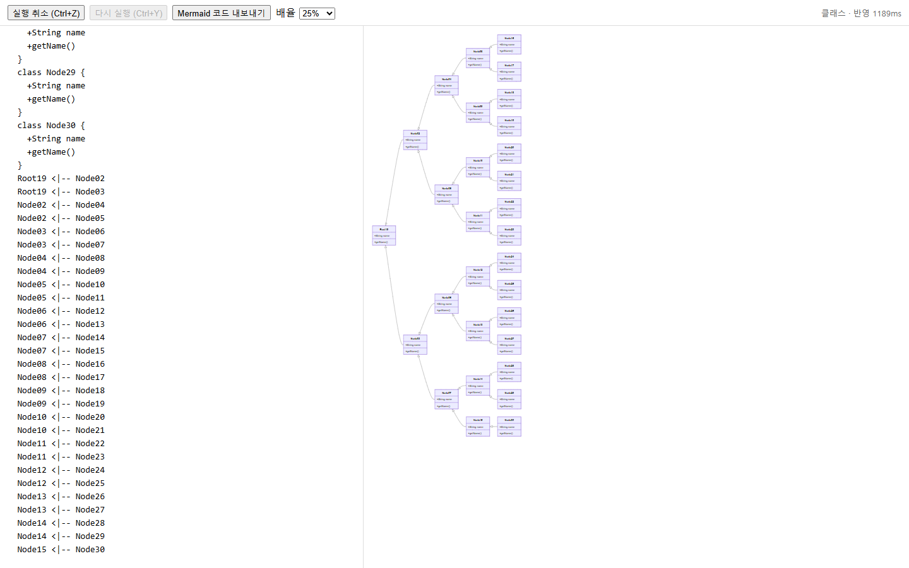
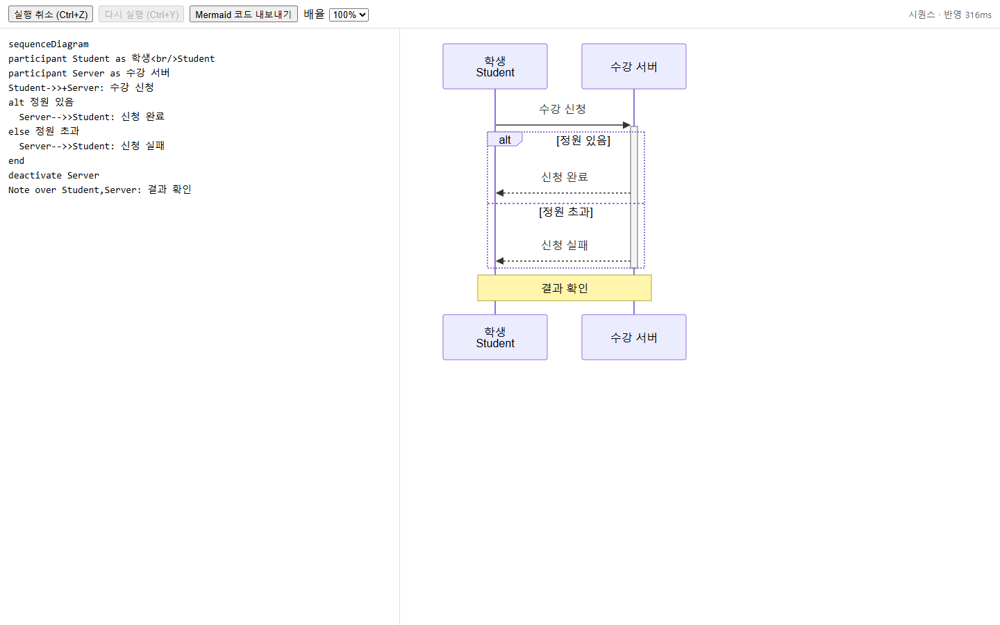
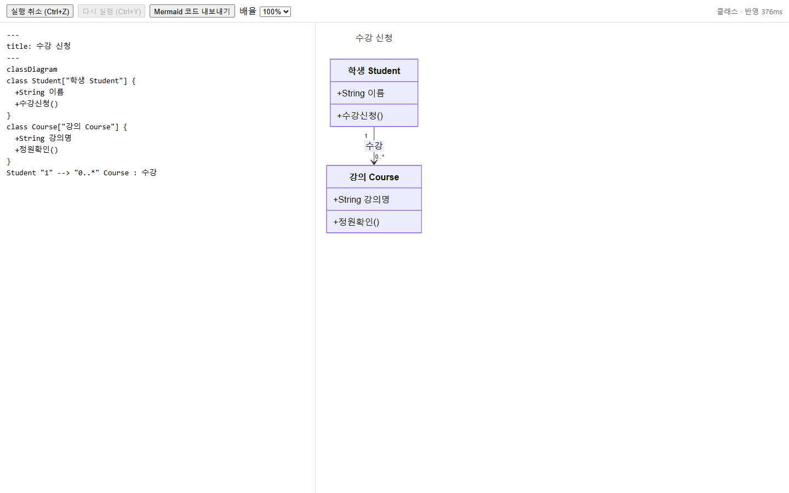

# 렌더링 주간 작업·시험 기록 — 김태환

작성일: 2026-11-18 (한국 시간) · 담당: `src/render/` · 요구사항: REQ-01, REQ-06, REQ-07

**측정과 기능 검증을 완료했다. 클래스 30개는 1초 성능 기준을 충족하지 못해 개선이 필요하다.**
폰트 확대·축소와 두 유형 생성은 아래 시험 범위에서 통과했다.

## 이번 주 할 일과 산출물

| 노션 기한 | 담당 과제 | 결과 |
| --- | --- | --- |
| 11/19 | 노드 30개 렌더링 시간 실측, 화면 상단 값 기록 | 클래스·시퀀스 각각 20회 측정, JSON·화면 캡처 저장 |
| 11/20 | `diagramTypes.test.ts` 케이스 추가 | 3개 → 20개. 주석, 빈 입력, 미지원 유형, 잘못된 접두어, frontmatter, 여러 줄 지시문 포함 |
| 11/22 | 확대·축소 폰트 스케일링 시험 결과 기록 | 25~400% 8개 배율, 클래스 90개·시퀀스 60개 라벨 검사. 비율 변화 0%, 넘침 0px |
| 11/23 | PR | 변경 코드·검증 기록·PR 설명 초안 준비. 사용자 요청에 따라 로컬 파일만 유지, 원격 게시 안 함 |

원본: [이번 주 할 일 (11/17~11/23)](https://www.notion.so/41b2614666928142af15f47b550b5352).
원문에 11/23이 일요일로 표시되어 있으나 2026-11-23은 월요일이다. 위 표는 날짜를 기준으로 옮겼다.
중간 점검 11/20, 기능 동결 11/27, 최종평가 11/30 일정은 원문을 따른다.

## 시험 환경과 방법

- 기반 저장소: `dlatkdwls/unidia`, main `8deb5b529302f0f43e1a969f15fdd23fd9f2a6ae`.
- 작업 브랜치: `codex/rendering-req-01-06-07`.
- 환경: Windows, Intel Core i7-10750H 2.60GHz, 논리 CPU 12개, RAM 16GiB.
- 브라우저: 설치된 Google Chrome 157.0.8103.79, Playwright headless, viewport 1440×900, 배율 100%에서 성능 측정.
- 실행: Node.js 24.18.0, Mermaid 11.17.2, Vite 6.4.5 개발 서버, Playwright 1.65.1.
- 최종 성능 측정 시각: 클래스 10:14, 시퀀스 10:15 KST. 별도의 빌드·시험 작업과 동시에 실행하지 않았다.
- 클래스는 노드 30개·상속 관계 29개이며 각 노드에 속성 1개와 메서드 1개가 있다.
  시퀀스는 참여자 30개·메시지 29개다.
- 앱의 기본 예제가 표시된 뒤 시험 코드를 입력한다. 첫 시험 코드 입력은 별도 기록하고,
  이후 클래스 이름 또는 메시지 내용을 20회 바꿔 측정한다. 주석만 바꾸거나 캐시된 SVG를 재사용하지 않는다.
- 화면 상단의 `반영 …ms`와 같은 원시 값을 읽는다. 마지막 입력부터 150ms 대기,
  Mermaid 처리, DOM 반영 및 두 번의 animation frame까지 포함한다. 최초 페이지 다운로드는 제외한다.
- p95는 정렬한 20개 값의 19번째 값이다. 일반 노트북 전체의 성능을 보증하는 결과는 아니다.

## REQ-01: 30개 노드 렌더링 시간

SRS 잠정 기준: 마지막 입력 후 화면 갱신까지 **95% 이상이 1,000ms 이내**.

| 유형 | 첫 시험 입력 | 평균 | p95 | 최댓값 | 1초 이내 | 판정 |
| --- | ---: | ---: | ---: | ---: | ---: | --- |
| 클래스 | 1,331.5ms | 1,232.2ms | 1,438.7ms | 1,478.5ms | 0/20 (0%) | 미달 |
| 시퀀스 | 468.6ms | 364.4ms | 395.5ms | 403.7ms | 20/20 (100%) | 통과 |

원시값: [클래스](measurements/2026-11-18/class-performance.json),
[시퀀스](measurements/2026-11-18/sequence-performance.json).
화면 상단은 정수로 반올림하므로 JSON 소수 값과 최대 0.5ms 차이가 난다.

첫 진단에서 클래스 렌더가 느린 현상을 재현했다. 별도 Chrome 프로파일링에서는
Mermaid 호출 한 번에 약 940ms가 걸렸으며 내부 설정 병합 작업이 주요 샘플에 나타났다.
이 값은 단일 진단값으로, 위 20회 최종 통계와 섞지 않았다. 라벨 HTML 사용 여부와 자동 줄바꿈 설정을
바꾸는 시도만으로는 충분한 개선을 확인하지 못했다.

후속 개선은 Mermaid 버전/렌더러 비교와 내부 설정 처리 비용 분석이 필요하다.
성능 시험의 1초 임계값을 완화하거나 실패를 숨기지 않았다.
`npm run test:performance`는 현재 클래스 기준 미달 때문에 실패한다.

시퀀스 30개 [화면 캡처](measurements/2026-11-18/sequence-30.png)도 함께 보관한다.
성능은 100% 배율에서 측정했으며 캡처 전에만 25%로 변경했다.

## REQ-06: 폰트 스케일링

폰트 크기와 도형 높이를 화면 좌표계에서 측정해 비율을 비교했다. 도형 내부 클래스 텍스트 90개와
시퀀스 참여자 텍스트 60개를 각 배율에서 검사했다.

| 배율 | 클래스 대표 폰트/도형 높이 | 시퀀스 대표 폰트/도형 높이 | 최대 비율 변화 | 최대 넘침 |
| --- | --- | --- | ---: | ---: |
| 25% | 4px / 30.75px | 4px / 16.25px | 0% | 0px |
| 50% | 8px / 61.5px | 8px / 32.5px | 0% | 0px |
| 75% | 12px / 92.25px | 12px / 48.75px | 0% | 0px |
| 100% | 16px / 123px | 16px / 65px | 0% | 0px |
| 150% | 24px / 184.5px | 24px / 97.5px | 0% | 0px |
| 200% | 32px / 246px | 32px / 130px | 0% | 0px |
| 300% | 48px / 369px | 48px / 195px | 0% | 0px |
| 400% | 64px / 492px | 64px / 260px | 0% | 0px |

글자 내용과 줄 수가 유지됐으며, 한글과 여러 줄 참여자 라벨도 25%·100%·400%에서 검사했다.
허용 오차 ±2% 기준을 통과했다. 넘침 검사에는 부동소수점 오차 0.1px를 허용했으며 실측은 0px였다.

원시값: [클래스](measurements/2026-11-18/class-font-scaling.json),
[시퀀스](measurements/2026-11-18/sequence-font-scaling.json).

이 시험은 **전체 다이어그램 배율**에 대한 결과다. 개별 노드 리사이즈, 모든 사용자 폰트/스타일,
실제 PNG/JPG 출력 품질은 이번 시험에 포함하지 않았다.

## REQ-07 및 회귀 검증

| 검사 | 결과 |
| --- | --- |
| `npm test` | 37/37 통과: 코어 10, 유형 판별 20, 스케줄러 7 |
| `npm run typecheck` | 통과 |
| `npm run build` | 통과 (Mermaid 번들 크기 안내 경고 있음) |
| 브라우저 기능 시험 | 6/6 통과 |
| 브라우저 성능 시험 | 1/2 통과, 클래스 실패 |
| `npx playwright test` 전체 | 7 통과, 1 실패 |

기능 시험에는 두 유형의 생성, 한글·여러 줄 라벨, 문법 오류 후 복구, 배율 유지,
여러 렌더러 인스턴스의 SVG ID 충돌 방지, viewport 해제 시 속성 복구가 포함된다.
스케줄러 단위 시험은 빠른 입력, 느린 렌더 중 입력 교체, 오래된 성공/오류 폐기와 해제를 확인한다.

두 유형의 코드 기반 생성은 검증했지만 GUI 드래그 편집은 오버레이 담당과의 통합이 남아 있다.
현재 main에는 노션에서 예고한 `feature/core` 변경이 아직 합쳐지지 않아, 그 API를 선반영하지 않았다.

## 중간 점검 때 공유할 내용

> 렌더링 담당입니다. 주석·빈 입력·미지원 유형을 포함한 유형 판별 테스트 20개를 추가했고,
> 전체 단위 테스트 37개와 타입 검사가 통과했습니다. 30개 노드에서 시퀀스 p95는 약 396ms,
> 클래스 p95는 약 1,439ms로 클래스 성능 개선이 필요합니다. 25~400% 폰트 비율 변화와
> 도형 밖 넘침은 시험 예제에서 모두 0이었습니다. 재현 코드, 원시값, 캡처와 연동 설명을 준비했습니다.

이 문구는 공유용 초안이며 팀 채팅이나 노션에는 게시하지 않았다.
